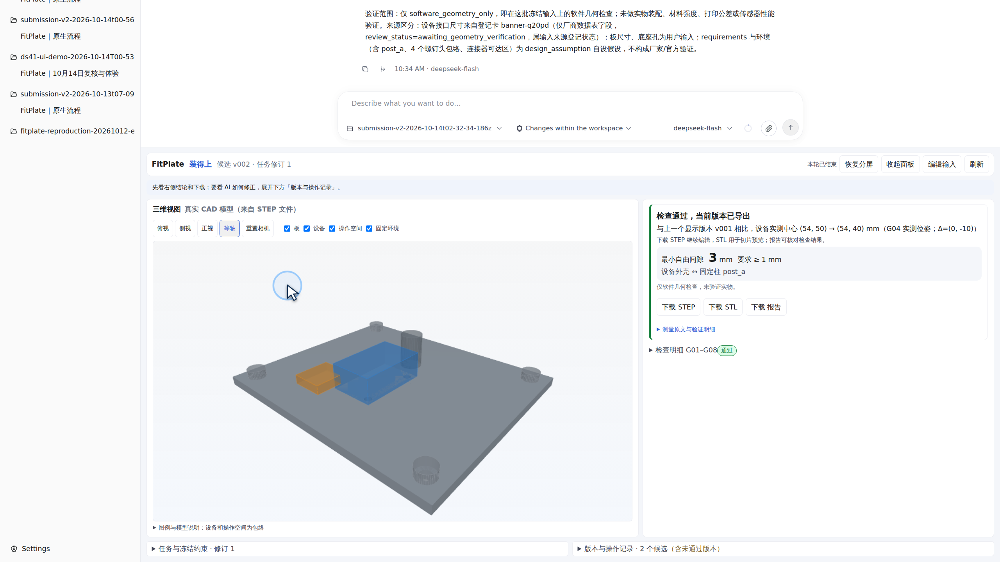

# FitPlate

FitPlate 是一个基于 Agnes Harness（AGH）的设备安装转接板设计工具。用户填写板尺寸、固定孔位、障碍物和设备允许移动的范围，模型调用 CAD 工具完成建模、检查和修订，输出 STEP、STL 和测量报告。

## 功能

- 分步填写安装条件，缺少信息时先补充，确认后开始设计。
- 生成真实 STEP，通过独立进程重新读取并检查几何。
- 按报告创建修订版本，保留失败候选和父版本关系。
- 查看三维模型、碰撞对象和版本差异，下载 CAD 与报告。

演示案例的板尺寸为 112 × 96 × 4 mm，保留四个底座孔和设备横向坐标，只允许纵向中心在 32–58 mm 内调整。初始中心 (54,50) 与固定柱干涉，自由间隙为 0 mm；模型调整为 (54,40) 后，测得间隙 3 mm，满足至少 1 mm 的要求。

设备和障碍物为几何包络。当前支持 Banner Q20PD 设备卡与矩形安装板，验证范围为软件几何；实物装配、强度和制造公差尚未验证。

## 运行

需要 Linux/WSL、Node 24.10+、Python 3.12、pnpm 和 Agnes Harness，产品流程使用官方 DeepSeek API。安装、配置和启动命令见 [安装配置](docs/安装配置.md)，操作与复现见 [运行说明](docs/运行说明.md)。

仓库包含已构建前端、依赖锁文件及公开输入样例，不含 API Key、个人运行配置和依赖目录。输入示例见 [examples/reproduction](examples/reproduction/README.md)。

## 文档与演示

[技术说明](docs/技术说明.md) · [测试报告](docs/测试报告.md) · [视频说明](docs/演示视频.md)

演示原视频为 [FitPlate-demo-v3.mp4](docs/video/FitPlate-demo-v3.mp4)。本地可打开 `docs/index.html` 播放；该目录也可作为 GitHub Pages 的发布源。

开发使用 Claude Code 调用 GLM5.3，以及 Codex 中的 Astra、6.1Sol 辅助编码、审查与修复；产品运行使用官方 DeepSeek deepseek-flash（DS-v4.1）。中文视频旁白为合成语音。

曾仁荣，江苏师范大学。2026 江苏省高校 AI+科学与工程创新实践黑客松，本科生组 U186，队名“依弦化羽”，单人参赛。

项目记录日期：2026年10月15日。实际提交时间见仓库提交记录。

代码许可见 [LICENSE](LICENSE)，第三方组件和设备资料来源见 [THIRD_PARTY.md](THIRD_PARTY.md)。
